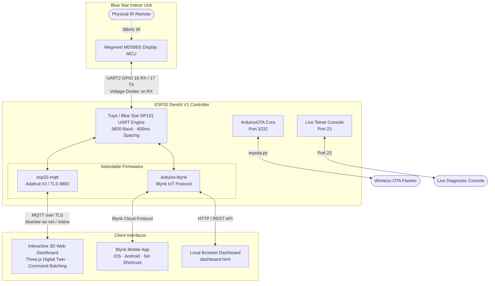

# Blue Star Smart AC (ESP32 Smart Controller & Web Dashboard)

[](https://platformio.org/)
[](https://www.espressif.com/)
[](https://io.adafruit.com/)
[](https://blynk.cloud/)
[](https://threejs.org/)
[](LICENSE)

An open-source, dual-firmware smart IoT controller and interactive **3D Web Dashboard** for Blue Star "smart ready" inverter split air conditioners equipped with the **Megmeet MD50BS** indoor display board.

Blue Star inverter ACs feature an unpopulated 4-pin Wi-Fi port on the indoor display board designed for Blue Star's optional dongle. This project replaces that dongle with an inexpensive **ESP32 DevKit V1 (or ESP32-C3)** to provide complete cloud and local control, real-time two-way synchronization, and deep hardware telemetry (compressor frequency in Hz, coil temperature, run hours, and filter alerts) never exposed on the physical remote.



---

## Highlights

* **Dual Firmware Ecosystem**:
  1. **[Web Dashboard & MQTT (`esp32-mqtt/`)](#option-a-web-dashboard--mqtt-edition)**: Connects to Adafruit IO or any MQTT broker over TLS. Paired with a desktop/mobile 3D AC digital twin web app.
  2. **[Blynk IoT Cloud (`arduino-blynk/`)](#option-b-blynk-iot-cloud-edition)**: Connects to Blynk Cloud for native iOS/Android mobile control, Apple Siri voice shortcuts, and a standalone zero-cloud local dashboard.
* **Smart Command Batching Engine**:
  * Adjusting multiple settings in the dashboard (e.g., Mode, Fan, and Temperature) queues and merges them into **a single consolidated JSON request**.
  * Eliminates broker rate limiting and prevents UART collisions with the AC display board.
* **Deep Hardware Diagnostics**:
  * **Inverter Compressor Frequency (Hz)**: Live motor speed (Key 24).
  * **Heat Exchanger Coil Temperature (°C)**: Evaporator cooling temperature (Key 62).
  * **Lifetime Run Counters**: Total AC powered hours and compressor runtime (Keys 43, 44, 59).
  * **Filter Clean ("FC") Alert**: Automated alert flag when 300 hours of runtime require filter washing.
* **Two-Way Synchronization**: Actions taken using the physical IR remote update the web and mobile dashboards in real time.
* **100% Wireless Maintenance (Zero USB Cable Needed)**:
  * **Wireless OTA Updates**: Flash new firmware or switch between MQTT and Blynk in ~15 seconds using `espota.py` on port `3232`.
  * **Live Telnet Console**: Stream real-time raw Tuya and decoded DP101 UART frames over Wi-Fi on port `23`.
  * **Non-Blocking Architecture**: Wi-Fi or broker disconnections never lock the CPU or starve OTA loops.

---

## Tested Models

| AC Model | Type | Display Board | Tuya Product ID | Verification Status |
| :--- | :--- | :--- | :--- | :---: |
| **IC318QNU** | 1.5 Ton 3-Star Inverter Split | Megmeet MD50BS | `ainbuzvozcqiiy3h` |  **Verified & Tested** |
| **IA318MXU** | Inverter Split | Megmeet MD50BS | `krxpotecxqamrq8p` |  **Verified & Tested** |
| **IE518TNUR** | Inverter Split | Megmeet MD50BS | `krxpotecxqamrq8p` |  **Verified & Tested** |

*All Blue Star split models bearing the "Smart Ready" or "Wi-Fi Ready" branding with an empty 4-pin CN2 header on the Megmeet MD50BS display board share this identical hardware interface and protocol.*

---

## Hardware & Wiring

### 1. Pinout & Connections

The 4-pin header is located on the display board behind the front panel of the indoor unit. Pin perspective is from the **module** side (`R_WIFI` = module receives, `T_WIFI` = module transmits).

| AC Header Pin | Function | Logic Level | ESP32 DevKit V1 Pin | Wiring / Conditioning Circuit |
| :--- | :--- | :--- | :--- | :--- |
| **`5V`** | DC Power Supply | 5.0 V | **`VIN`** (or `5V`) | Direct wire (powers ESP32 directly from AC) |
| **`GND`** | Ground | 0 V | **`GND`** | Direct wire (common ground) |
| **`R_WIFI`** | AC TX (Transmit) | 5.0 V Idle | **`GPIO 16 (RX2)`** | **Voltage Divider (5V $\to$ 3.3V)**:<br>• $5\text{ k}\Omega$ in series with the line<br>• $10\text{ k}\Omega$ from GPIO 16 to Ground |
| **`T_WIFI`** | AC RX (Receive) | ~1.5 V Float | **`GPIO 17 (TX2)`** | **Direct wire** (ESP32 drives line; 40mA drive capability enabled) |

> ⚠️ **CRITICAL HARDWARE PRECAUTIONS:**
> 1. **Never Connect USB and AC 5V Simultaneously**: The ESP32 DevKit V1 lacks reverse-voltage isolation between USB VBUS and VIN. Connecting both at once can back-feed voltage and destroy your computer's USB port or the ESP32. **Always disconnect the AC 5V wire before plugging in a USB cable.**
> 2. **Turn Off Mains Breaker**: Mains voltage (230V AC) is present on adjacent terminal blocks inside the indoor unit. Switch off the circuit breaker before opening the front grille.
> 3. **Avoid GPIO 1 & GPIO 3 on DevKit Boards**: GPIO 1 (`TX0`) and GPIO 3 (`RX0`) are tied to the onboard CP2102/CH340 USB chip. Connecting the AC to these pins causes bus contention and boot failure. Always use **UART2 (`GPIO 16` & `GPIO 17`)**.

---

### 2. Voltage Divider Schematic

```text
       AC Display Board                                     ESP32 DevKit V1
      (4-Pin Wi-Fi Port)                                     (30-Pin Module)
    ┌──────────────────┐                                 ┌──────────────────┐
    │                  │                                 │                  │
    │ [5V] ────────────┼────────── Red Wire ─────────────┼──────────> [VIN] │
    │                  │                                 │                  │
    │ [GND] ───────────┼──────┬─── Black Wire ───────────┼──────────> [GND] │
    │                  │      │                          │                  │
    │                  │      │    ┌───────────────┐     │                  │
    │                  │      └───┤ 10 kΩ Resistor │     │                  │
    │                  │           └───────┬───────┘     │                  │
    │                  │                   │ (3.3V tap)  │                  │
    │ [R_WIFI] (5V) ───┼─[ 5 kΩ Resistor ]─┴─────────────┼──> [GPIO 16 (RX2)]
    │                  │                                 │                  │
    │ [T_WIFI] ◄───────┼────────── Green Wire ───────────┼──── [GPIO 17 (TX2)]
    │                  │                                 │                  │
    └──────────────────┘                                 └──────────────────┘
```

> 💡 **Resistor Assembly Note:** If a $5\text{ k}\Omega$ resistor is unavailable, connect **two $10\text{ k}\Omega$ resistors in parallel** (yielding $5\text{ k}\Omega$). Then use a third $10\text{ k}\Omega$ resistor to Ground.

---

## Option A: Web Dashboard & MQTT Edition

Located in [`esp32-mqtt/`](esp32-mqtt/) and [`web-dashboard/`](web-dashboard/).

### Features:
* **Interactive 3D Digital Twin**: High-performance Three.js procedural model of the Blue Star indoor unit with working animated louvers, cross-flow blower spin matched to fan speed, dynamic 7-segment LED canvas texture, and synthesized compressor/air audio.
* **Auto-Batching Engine**:
  * Clicking multiple buttons (e.g. adjusting target temperature by 3°C, setting Fan to High, and toggling Cool mode) updates the UI instantly with zero latency.
  * The dashboard waits **900 ms** after the last touch and dispatches all accumulated changes in **one single atomic JSON message** to the `bluestar-ac-set` feed.
  * Eliminates broker rate limits and prevents AC MCU frame drops.
* **Whole-Number Temperature**: Clean 1°C steps (`16°C` to `30°C`) without fractional decimal increments.
* **Echo Protection**: Prevents incoming broker echoes from overwriting settings currently in the local batch queue.
* **Zero Server Setup**: Open [`web-dashboard/index.html`](web-dashboard/index.html) directly in any web browser or deploy with 1-click to Vercel via [`vercel.json`](web-dashboard/vercel.json).

### MQTT Feeds:
* **Publish Topic**: `<username>/feeds/bluestar-ac-status` (ESP32 publishes state JSON, retained)
* **Subscribe Topic**: `<username>/feeds/bluestar-ac-set` (ESP32 receives batched commands JSON)

### Sample Batched Command Payload:
```json
{
  "power": 1,
  "mode": 1,
  "fan": 4,
  "targetTemp": 24,
  "vane": 0,
  "hSwing": 1
}
```

---

## Option B: Blynk IoT Cloud Edition

Located in [`arduino-blynk/`](arduino-blynk/).

### Features:
* **Native Mobile Apps**: Pre-built widgets on the Blynk iOS and Android apps for phone-based control.
* **Apple Siri Voice Shortcuts**: Control AC power and setpoint with voice commands via native Blynk HTTPS Webhooks.
* **Local Web Dashboard**: Includes [`arduino-blynk/dashboard.html`](arduino-blynk/dashboard.html) for fast browser-based control on your local network.
* **Full Datastream Map**:

| Pin | Name | Type | Range / Values | Function |
| :---: | :--- | :---: | :---: | :--- |
| **`V0`** | Power | Int | `0` / `1` | Power state (0=Off, 1=On) |
| **`V1`** | Target Temp | Double | `16.0` – `30.0` | Target temperature setpoint (°C) |
| **`V2`** | Mode | Int | `1` – `4` | 1=Cool, 2=Dry, 3=Fan, 4=Auto |
| **`V3`** | Fan Speed | Int | `1` – `6` | 1=Quiet, 2=Low, 3=Med, 4=High, 5=Turbo, 6=Auto |
| **`V4`** | Display Light | Int | `0` / `1` | Indoor unit LED display |
| **`V5`** | Room Temp | Double | `0.0` – `50.0` | Ambient temperature from AC sensor |
| **`V6`** | Vertical Vane | Int | `0` – `6` | 0=Auto Swing, 1=Top ... 5=Bottom, 6=Off |
| **`V7`** | Horizontal Swing | Int | `0` / `1` | Motorized horizontal side swing |
| **`V8`** | Convertible Mode | Int | `0` – `4` | 0=Normal, 1=100%, 2=80%, 3=60%, 4=40% (Status) |
| **`V9`** | Eco Mode | Int | `0` / `1` | Energy Saver mode (displays "E") |
| **`V10`**| Turbo Cool | Int | `0` / `1` | 110% Boost mode (displays "HC") |
| **`V11`**| Comfort Sleep | Int | `0` / `1` | +1°C/hr internal temperature ramp |
| **`V13`**| AC Run Hours | Double | `0.0` – `99999.0`| Total AC power runtime (Hours) |
| **`V14`**| Comp Run Hours | Double | `0.0` – `99999.0`| Compressor motor runtime (Hours) |
| **`V17`**| Compressor Speed | Int | `0` – `120` | Real-time inverter frequency (Hz) |
| **`V18`**| Coil Temp | Double | `-10.0` – `60.0`| Evaporator coil temperature (°C) |
| **`V19`**| Query Diagnostics| Int | `0` / `1` | On-demand trigger for Keys 24 & 62 |

---

## Firmware Build & Wireless Flashing

Both firmware projects use **[PlatformIO](https://platformio.org/)**.

### Initial Flash (Over USB)

> ⚠️ Ensure the AC 5V wire is disconnected before attaching the USB cable!

```powershell
# 1. Clone the repository
git clone https://github.com/Fizan-Feroz/Bluestar-SMART.git
cd Bluestar-SMART

# 2. Configure credentials
# For Web/MQTT firmware:
cp esp32-mqtt/src/secrets.example.h esp32-mqtt/src/secrets.h
# Edit Wi-Fi and Adafruit IO / MQTT broker credentials in esp32-mqtt/src/secrets.h

# 3. Build and flash via USB
cd esp32-mqtt
pio run --target upload
```

---

### Wireless Updates (Over-The-Air)

Once the ESP32 is connected to your Wi-Fi network, physical USB access is never required again. All updates and firmware switching can be done over Wi-Fi on port `3232`.

#### Flash Web / MQTT Firmware via OTA:
```powershell
python "$HOME\.platformio\packages\framework-arduinoespressif32\tools\espota.py" -i 192.168.1.59 -p 3232 -f esp32-mqtt\.pio\build\esp32dev\firmware.bin
```

#### Revert to Blynk Firmware via OTA:
```powershell
python "$HOME\.platformio\packages\framework-arduinoespressif32\tools\espota.py" -i 192.168.1.59 -p 3232 -f arduino-blynk\.pio\build\esp32dev\firmware.bin
```

---

## Live Wireless Console & Diagnostic Tools

Both firmwares host a live Telnet console on port `23` for real-time monitoring and debugging without a serial cable.

### 1. Connect to Live Console:
```powershell
telnet 192.168.1.59 23
```

### 2. Available Console Commands:
* `i` — Print system summary (Wi-Fi RSSI, IP, MQTT broker state, AC status, compressor Hz, coil temp, run hours).
* `h` — Re-trigger Tuya handshake sequence with the AC MCU.
* `q` — Query extended diagnostics (Key 24 compressor frequency and Key 62 coil temperature).
* `s` — Transmit a silent Tuya keepalive heartbeat (`0x00`).
* `r` — Soft-reboot the ESP32.

### 3. Diagnostic Python Utilities ([`scripts/`](scripts/)):
* [`scripts/query_diag.py`](scripts/query_diag.py) — Connects to Telnet, requests Keys 24 & 62, and prints formatted compressor diagnostics.
* [`scripts/sniff_remote.py`](scripts/sniff_remote.py) — Live sniffer that logs raw AC UART records when physical IR remote buttons are pressed.
* [`scripts/monitor.py`](scripts/monitor.py) — Continuous background terminal stream of AC events and sensor deltas.

---

## Protocol Overview

Communications use the Tuya MCU serial protocol with a proprietary Blue Star ASCII record encapsulation (DP101) protected by a CRC-16/MODBUS checksum:

$$\texttt{*LLKKV...CCCC\#}$$

* `LL`: 2-digit hex length of `KK` + `V`.
* `KK`: 2-digit hex function key.
* `V`: Hex/ASCII value payload.
* `CCCC`: 4-digit uppercase hexadecimal **CRC-16/MODBUS** (polynomial `0x8005` reflected, initial `0xFFFF`) calculated over `*LLKKV...`.

```
 *   03   15   1   DACF   #
 │   │    │    │   │      └ Delimiter (#)
 │   │    │    │   └ CRC-16/MODBUS checksum
 │   │    │    └ Value (1 = On)
 │   │    └ Key (15 = Display Light)
 │   └ Length in hex (3 characters: '15' + '1')
 └ Header (*)
```

### Key Reference Summary

| Key | Read/Write | Function | Values & Encoding |
| :---: | :---: | :--- | :--- |
| **`01`** | R/W | Power | `0` (Off), `1` (On) |
| **`02`** | R/W | Target Temperature | 3 hex digits = °C $\times$ 10 (`0F0` = 24.0°C, `104` = 26.0°C) |
| **`03`** | R/W | Operating Mode | `2` (Cool), `3` (Dry), `0` (Fan Only), `4` (Auto) |
| **`04`** | R/W | Fan Speed | `1` (Quiet), `2` (Low), `3` (Med), `4` (High), `6` (Turbo), `7` (Auto) |
| **`05`** | R/W | Vertical Vane | `0` (Auto Swing), `1` (Top) … `5` (Bottom), `6` (Off) |
| **`06`** | R/W | Horizontal Swing | `0` (Auto Swing), `6` (Off) |
| **`07`** | R/W | Turbo Cool | `3` (On), `0` (Off) — Forces 16°C and Turbo fan for ~20 mins |
| **`11`** | R/W | Comfort Sleep | `1` (On), `0` (Off) — Raises temperature by +1°C/hr internally |
| **`15`** | R/W | Display Light | `1` (On), `0` (Off) |
| **`22`** | R/W | Eco Mode | `1` (On), `0` (Off) — Sets setpoint to 24°C, displays "E" |
| **`24`** | Read | Compressor Frequency | Inverter motor speed in **Hz** (`0x23` = 35 Hz) |
| **`55`** | Read | 5-in-1 Convertible | `0` (Normal), `1` (100%), `2` (80%), `3` (60%), `4` (40%) *(MCU Status Report)* |
| **`58`** | R/W | Buzzer Mute | `1` (Muted), `0` (Beep enabled) |
| **`62`** | Read | Heat Exchanger Coil Temp | Indoor cooling coil temp in 0.1°C units (`0x0EB` = 23.5°C) |
| **`99`** | Read | Room Temperature | Ambient temperature in 0.1°C units, pushed every 60s |
| **`43/44`**| Read | Run Time Counters | Lifetime compressor run hours and total unit powered hours |

*Full protocol specifications, packet structures, and reverse-engineering findings are detailed in [**`docs/PROTOCOL.md`**](docs/PROTOCOL.md).*

---

## Critical Gotchas & Troubleshooting

1. **The `pinMode()` Trap in ESP32 Arduino Core**:
   Never call `pinMode(AC_RX_PIN, ...)` after `acSerial.begin()`. In the ESP32 Arduino framework, calling `pinMode()` on an active hardware UART pin detaches the GPIO matrix from the UART peripheral, causing the ESP32 to silently receive 0 bytes.
2. **AC MCU Buzzer on Writes**:
   The AC indoor unit sounds an audible buzzer beep on every write command (`CMD_DP_SET 0x06`). **Do not use high-frequency background polling loops.** Routine keepalives must use native Tuya `CMD_HEARTBEAT (0x00)` which the AC acknowledges **100% silently**.
3. **Mandatory 400ms Frame Spacing**:
   The Megmeet display board MCU requires $\ge 400\text{ ms}$ between consecutive UART transmissions. Sending back-to-back frames without spacing causes the AC MCU to drop frames. Both firmware implementations include automated TX spacing queues.
4. **Convertible Mode (Key 55)**:
   On the Megmeet MD50BS display board, Key 55 is **read-only / status reporting**. The AC MCU ignores serial writes to Key 55; convertible modes are set using the physical IR remote, after which the AC reports the mode and caps the fan speed over UART.
5. **OTA Safety Window**:
   When updating firmware over Wi-Fi, wait ~15 seconds for the write cycle to finish. Non-blocking MQTT reconnection logic guarantees the ESP32 will never lock out OTA access even if cloud services are temporarily offline.

---

## Repository Structure

```text
├── esp32-mqtt/              # PlatformIO project: MQTT + Adafruit IO firmware
│   ├── src/main.cpp         # Non-blocking MQTT, OTA, Telnet console, batch dispatch
│   └── src/secrets.h        # Wi-Fi & Adafruit IO credentials
├── web-dashboard/           # Modern 3D Web Dashboard (Three.js Digital Twin)
│   ├── index.html           # Single-page interactive AC UI with audio synthesis
│   └── vercel.json          # 1-click Vercel deployment configuration
├── arduino-blynk/           # PlatformIO project: Standalone Blynk IoT firmware
│   ├── src/main.cpp         # Blynk IoT handler, UART engine, Telnet server
│   ├── dashboard.html       # Local standalone browser dashboard
│   └── README.md            # Detailed Blynk setup & Siri Shortcuts guide
├── scripts/                 # Python diagnostic and reverse-engineering utilities
│   ├── query_diag.py        # Telnet diagnostic polling tool
│   ├── sniff_remote.py      # Real-time UART sniffer for IR remote decoding
│   └── monitor.py           # Real-time console event monitor
├── docs/                    # Architectural documents and protocol captures
│   ├── PROTOCOL.md          # Complete reverse-engineered protocol documentation
│   └── images/              # Pinout diagrams, board schematics, and UI previews
└── README.md                # Main repository documentation
```

---

## Contributing

Contributions, bug reports, and telemetry logs from additional Blue Star models are welcome!
* If you test a different Blue Star model, submit an issue or PR with your model number, indoor display board model, and the boot handshake dump (`Record 00=...`).
* Protocol additions or newly decoded keys can be submitted directly against [`docs/PROTOCOL.md`](docs/PROTOCOL.md).

---

## Disclaimer & License

This project is an independent community reverse-engineering effort and is not affiliated with, endorsed by, or associated with Blue Star Limited or Tuya Inc. Opening indoor air conditioning equipment carries risk of electric shock and may impact manufacturer warranties. Proceed at your own risk.

Licensed under the [MIT License](LICENSE).
